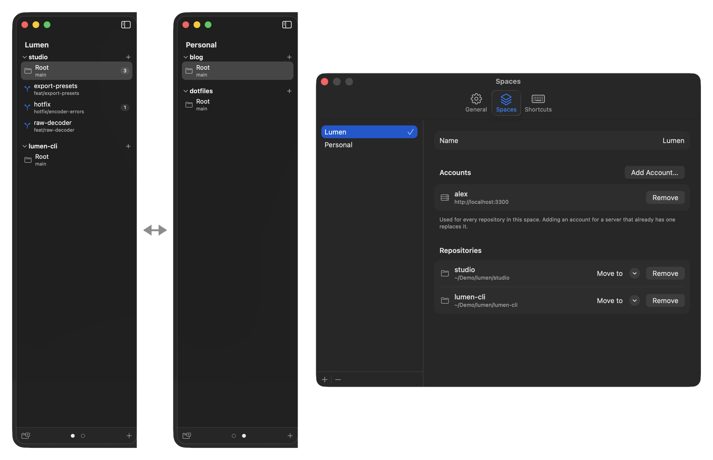
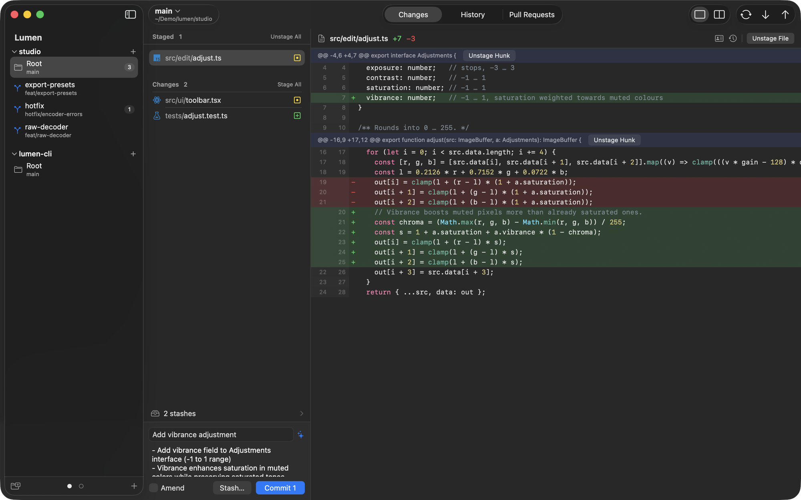
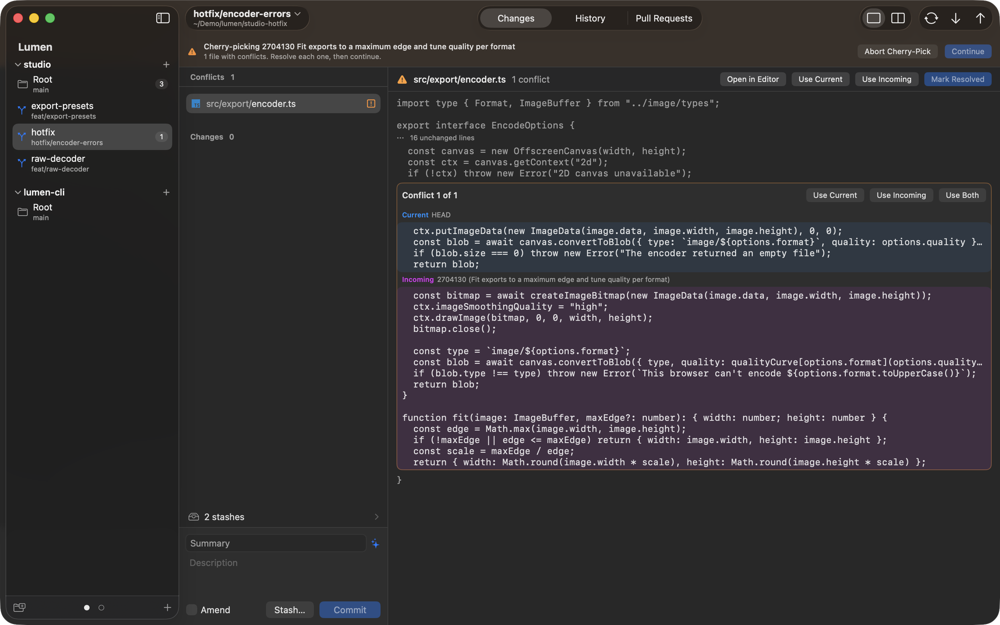
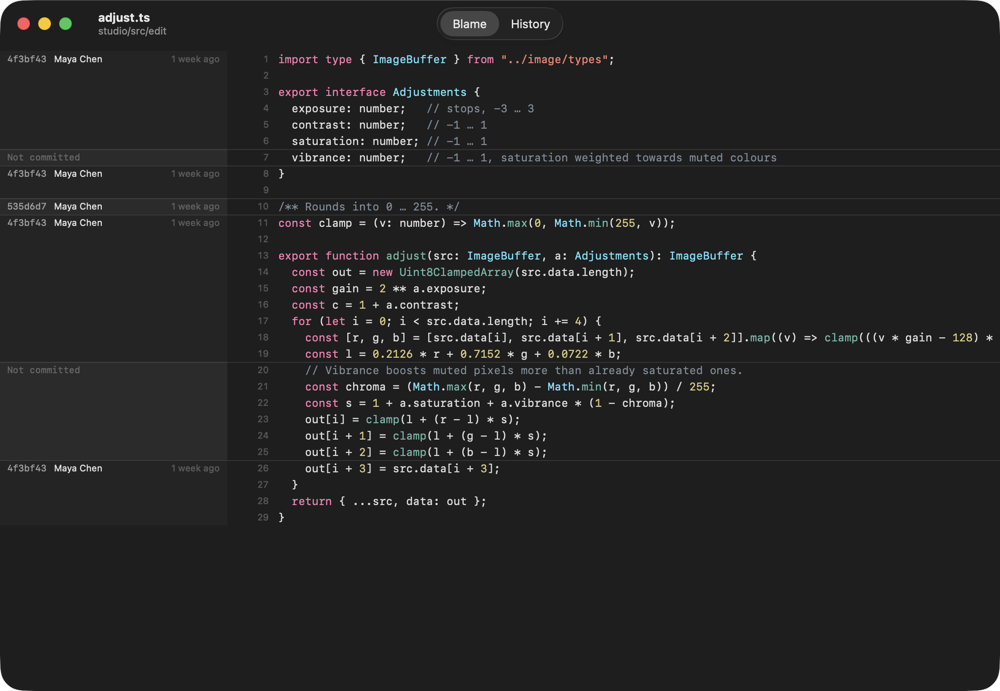

# Loupe

A native macOS git client built for reviewing code: your own uncommitted changes, large pull requests on
GitHub, Forgejo and Gitea, and many worktrees across many repositories, organised into spaces.

**[Download Loupe for macOS](https://github.com/exTypen/loupe/releases/latest)**: free and open source, signed and
notarized, for macOS 15 or later.


## Highlights

**Spaces, with their own accounts.** Group repositories into spaces, as in Arc: one for work, one for side
projects, one per client. Swipe two fingers across the sidebar to page between them. Each space has its own
GitHub, Forgejo or Gitea accounts, so the same server can have a different login in each space. Fetch, pull,
push and pull request checkout over HTTPS use that space's token instead of whatever the system credential
helper holds.



**Review big pull requests on the desktop.** Viewed files that become unviewed again when a new push changes
them, inline comments, drafts that survive restarts, Approve and Request Changes, merge, and CI checks with
live Forgejo Actions logs. It works the same on GitHub, Forgejo and Gitea, and pull requests GitHub's web UI
won't show (over 300 files or 20,000 lines) are diffed locally.


**Built for many worktrees.** Every repository lists all its worktrees with their branch, ahead/behind counts
and uncommitted changes. ⌘K jumps between them, and a pull request checks out into its own worktree in one
click.

**Fast, and native.** A SwiftUI app with an AppKit diff renderer. A 150,000-line file opens in under a second
and scrolls smoothly.

**AI commit messages from the tool you already have.** ✨ in the commit box writes the message with Claude Code,
Codex, Gemini CLI, GitHub Copilot CLI, Cursor CLI, opencode, Qwen Code, Amp or Factory Droid, whichever is
installed, on your own subscription and in the tool's read-only mode. Pick the tool, the model and a style.



Every git operation runs through the `git` command line, so hooks, commit signing and credential helpers behave
exactly as they do in your terminal.

## Features

**Spaces and worktrees**
- Spaces: add, rename, reorder and delete them in Settings, switch with a swipe or the dots under the sidebar.
  Drag a repository header to reorder it, or onto a space's dot to move it there.
- Each repository header has its own button for a new worktree. Rows show the worktree's folder, with the
  branch checked out in it underneath.
- Switch the branch of the current worktree from the title bar. Picking a remote branch creates a local
  branch that tracks it.
- Remove and prune worktrees, and open them in Finder, Terminal, Zed or VS Code. Worktrees added or removed
  outside Loupe show up on their own.
- The file list updates as soon as files change on disk, including a linked worktree's index under
  `.git/worktrees/`.

**Local changes**
- Staged and unstaged lists, unified or split diff, syntax highlighting for about twenty-five languages,
  intra-line highlights.
- Stage, unstage or discard a hunk, a selection of lines, or whole files; select several files to act on them
  at once.
- Commit with a summary and a description, or amend. Stash everything or just the selected files.
- When a merge, cherry-pick, revert or rebase stops on conflicts, a banner offers Abort and Continue, and each
  conflict shows its two sides with Use Current, Use Incoming and Use Both.



**History**


- The current branch, all branches, any single branch, or your stashes, with a commit graph and each commit's
  full diff. Search by message or author.
- Cherry-pick a commit onto your branch, or revert one. Apply, pop or drop a stash.
- Blame and file history for any file in their own window. Blame can step back to before a commit; file
  history follows renames.


- Start a new worktree from any commit.

**Pull requests**
- List and filter pull requests, then open one full-width with a collapsible file tree.
- Mark files as viewed and jump to the next unviewed one.
- Review comments render inline at their lines. Right-click a line and choose Add Comment to write one.
- Submit as Comment, Approve or Request Changes; merge; read and reply in the conversation tab.
- Check out, open in the browser or copy the link from the header.
- See CI status. Forgejo Actions logs stream live inside the app; GitHub checks open in the browser.

**Performance**
- The diff is a virtualized `NSTableView` whose rows draw themselves; the parser handles 200,000 diff lines in
  about 40 ms.
- GitHub refuses to serve diffs over 300 files or 20,000 lines. Loupe fetches the pull request and computes
  the same diff locally instead.

## Install

Download `Loupe-<version>.dmg` from the [latest release](https://github.com/exTypen/loupe/releases/latest), open it
and drag Loupe to Applications. The app is signed with a Developer ID and notarized by Apple.

Loupe needs macOS 15 or later, and git (the Xcode Command Line Tools or Homebrew git).

## Building from source

Building needs Xcode 16 or later (Swift 6 toolchain).

```sh
git clone https://github.com/exTypen/loupe.git
cd loupe
scripts/bundle.sh            # builds build/Loupe.app
scripts/bundle.sh --install  # also copies it to /Applications
```

`bundle.sh` signs with the first code-signing identity it finds: a Developer ID certificate, then an Apple
Development one, then an ad-hoc signature. With an ad-hoc signature macOS asks for Keychain access again after
every rebuild, because the stored tokens are bound to the app's signature. Set `LOUPE_SIGN_ID` to choose an
identity.

## Connecting accounts

Pull requests need an account for the server the repository's remote points to. Accounts belong to a space:
open Settings (⌘,) › Spaces, pick the space and choose Add Account. HTTPS and SSH remotes both work; Loupe
matches them to an account by hostname. Over HTTPS, the account's token is also what fetch, pull and push use,
so give it write access to the repository.

**GitHub**: choose GitHub. **Use GitHub CLI Token** takes the token that `gh auth login` stored. You can also
paste a personal access token. A fine-grained token needs read and write access to Pull requests and Contents,
and read access to Commit statuses and Checks. For GitHub Enterprise Server, enter your server's URL.

**Forgejo or Gitea**: enter the server URL and an access token from Settings → Applications, with
read and write access to `repository` and `issue`.

Tokens are stored in the macOS Keychain.

## Keyboard shortcuts

The ⌘ shortcuts below are the defaults; change any of them in Settings › Shortcuts.

| Key | Action |
|---|---|
| ⌘K | Go to worktree |
| ⌘O | Open a repository (or drag a folder onto the window) |
| ⌘1 / ⌘2 / ⌘3 | Changes / History / Pull Requests |
| ⇧⌘S | Show or hide the sidebar |
| Two-finger swipe on the sidebar | Previous / next space |
| ⌥↓ / ⌥↑ | Next / previous file |
| `n` / `p` (in diff) | Next / previous hunk |
| `v` (in diff) or ⇧⌘V | Mark the file viewed and go to the next unviewed one |
| Space (file list) | Stage / unstage the selected files |
| ⌫ (file list) | Discard the selected files |
| ⌘↩ | Commit, add a comment, or submit a review |
| ⌘R | Refresh |
| ⌘[ | Back to the pull request list |

## Development

```sh
swift build
swift test                                         # parsers, staging, blame and the graph against real repositories
LOUPE_GH_LIVE=1 swift test --filter GitHubLive     # GitHub client against api.github.com (uses `gh auth token`)
LOUPE_AI_LIVE=1 swift test --filter CommitAILive   # a commit message from the local `claude` CLI
```

`scripts/release.sh` builds a signed, notarized and stapled DMG. Its header lists the one-time setup: a
Developer ID Application certificate and stored notary credentials.

## Not built yet

Interactive rebase, stacked pull requests, GitLab and Bitbucket, threaded replies to review comments,
re-running CI jobs, live GitHub Actions logs, and syncing viewed files with GitHub.

## License

[MIT](LICENSE).

File-type icons come from [Material Icon Theme](https://github.com/material-extensions/vscode-material-icon-theme)
(MIT) and are embedded by `scripts/gen-file-icons.py`.
