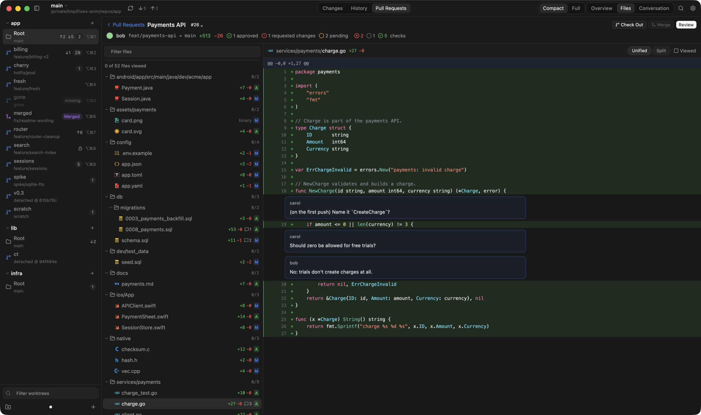
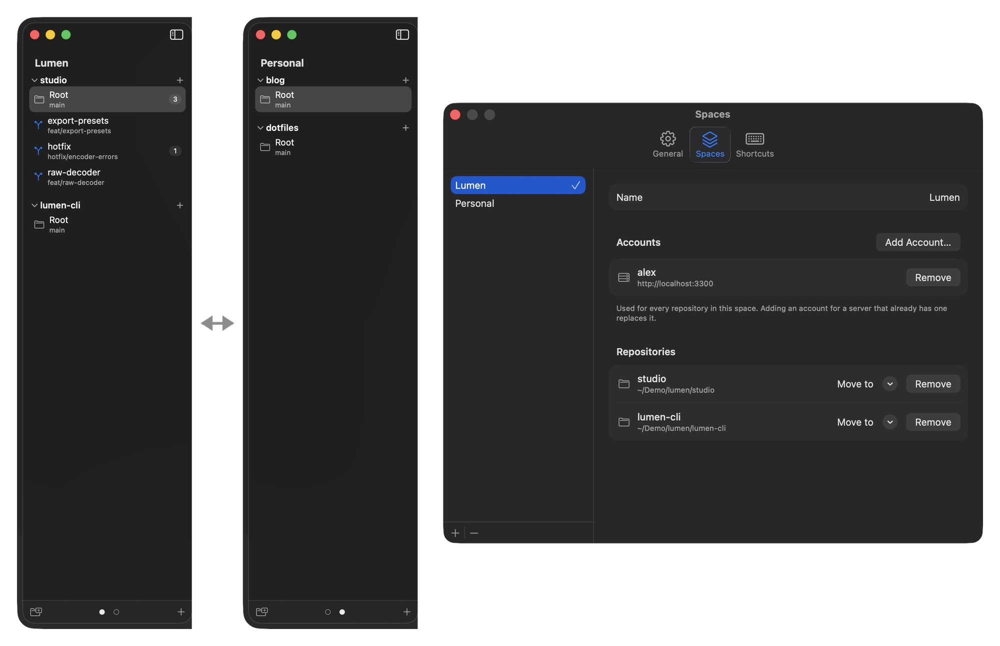
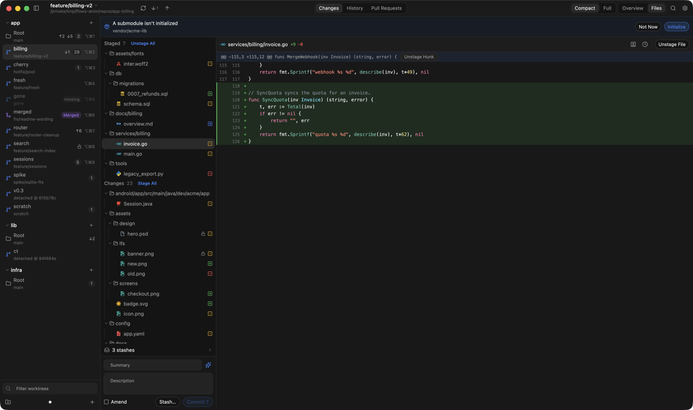
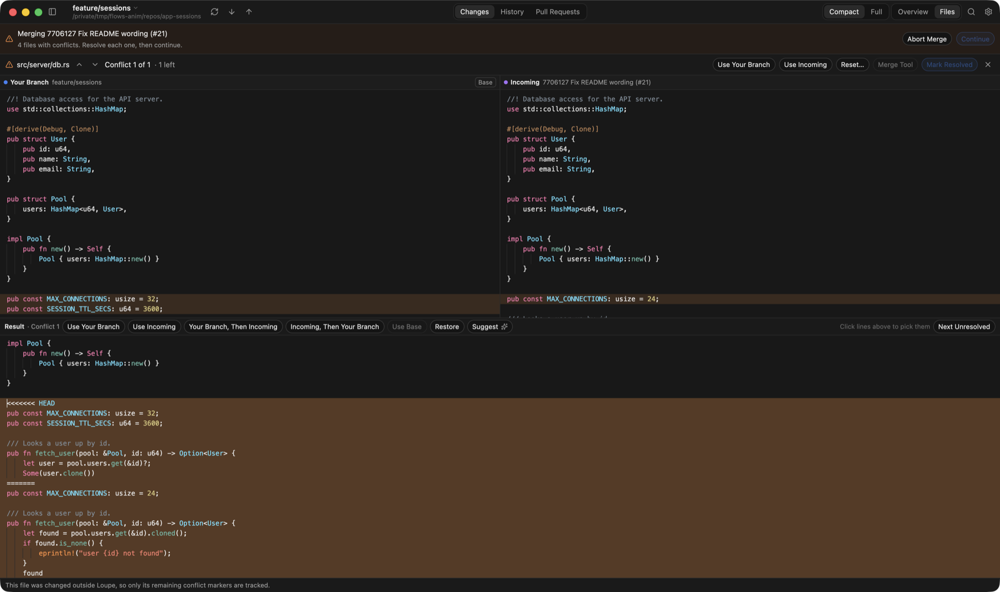
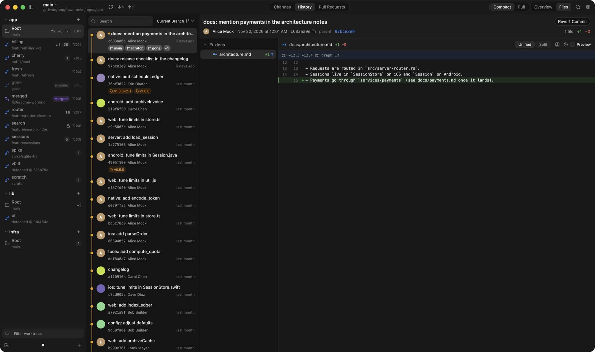
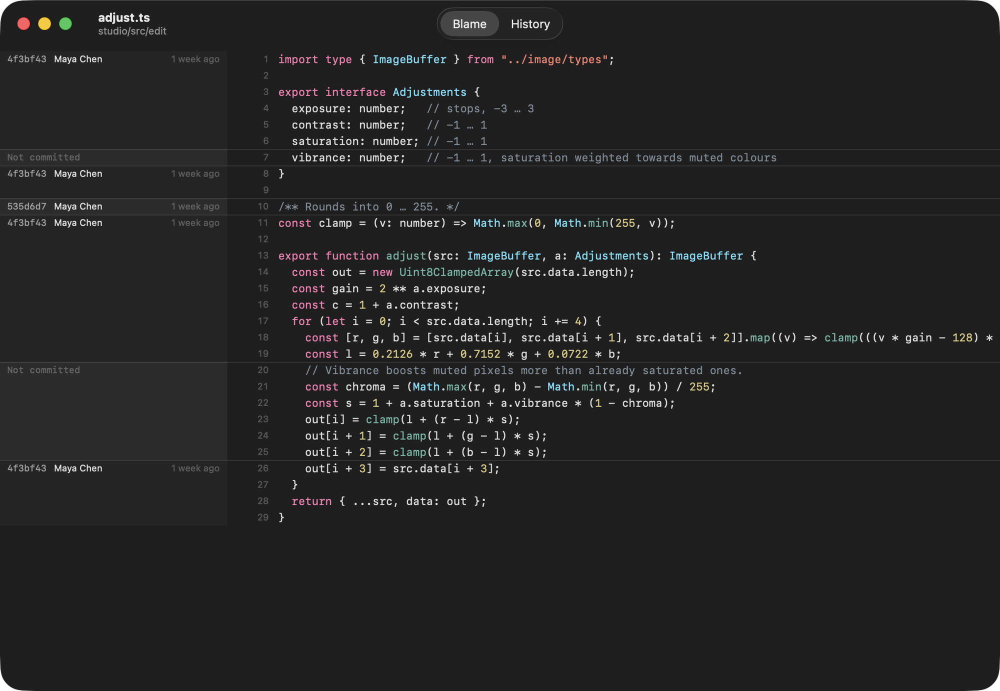

# Loupe

A native macOS git client built for reviewing code: your own uncommitted changes, large pull requests on
GitHub, Forgejo and Gitea, and many worktrees across many repositories, organised into spaces.

**[Download Loupe for macOS](https://github.com/exTypen/loupe/releases/latest)**: free and open source, signed and
notarized, for macOS 15 or later.



## Highlights

**Spaces, with their own accounts.** Group repositories into spaces, as in Arc: one for work, one for side
projects, one per client. Swipe two fingers across the sidebar to page between them. Each space has its own
GitHub, Forgejo or Gitea accounts, so the same server can have a different login in each space. Fetch, pull,
push and pull request checkout over HTTPS use that space's token instead of whatever the system credential
helper holds.



**Forgejo and Gitea, treated like GitHub.** Open, review and merge pull requests on all three: viewed files that
become unviewed again when a new push changes them, inline comments, drafts that survive restarts, Approve and
Request Changes. CI jobs, steps and live logs show in the app on every forge, with Re-run and Cancel.


**Built for many worktrees.** Every repository lists all its worktrees with their branch, ahead/behind counts
and uncommitted changes. ⌘K jumps between them, and a pull request checks out into its own worktree in one
click.

**The whole git workflow.** Drag commits in History to reorder or squash them, resolve conflicts in a three-way
merge editor, undo what Loupe did with ⌘Z, and work with Git LFS and submodules.

**Fast, and native.** A SwiftUI app with an AppKit diff renderer. A 150,000-line file opens in under a second
and scrolls smoothly.

**AI commit messages from the tool you already have.** ✨ in the commit box writes the message with Claude Code,
Codex, Gemini CLI, GitHub Copilot CLI, Cursor CLI, opencode, Qwen Code, Amp or Factory Droid, whichever is
installed, on your own subscription and in the tool's read-only mode. Pick the tool, the model and a style.



Every git operation runs through the `git` command line, so hooks, commit signing and credential helpers behave
exactly as they do in your terminal.

## Features

**Spaces and worktrees**
- Spaces: add, rename, reorder and delete them in Settings, switch with a swipe or the dots under the sidebar.
  Drag a repository header to reorder it, or onto a space's dot to move it there.
- Each repository header has its own button for a new worktree. Rows show the worktree's folder, with the
  branch checked out in it underneath.
- Switch the branch of the current worktree from the title bar. Picking a remote branch creates a local
  branch that tracks it.
- Remove and prune worktrees, and open them in Finder, Terminal, Zed or VS Code. Worktrees added or removed
  outside Loupe show up on their own.
- The file list updates as soon as files change on disk, including a linked worktree's index under
  `.git/worktrees/`.

**Local changes**
- Staged and unstaged lists, unified or split diff, syntax highlighting for about twenty-five languages,
  intra-line highlights.
- Stage, unstage or discard a hunk, a selection of lines, or whole files; select several files to act on them
  at once.
- Commit with a summary and a description, or amend. Stash everything or just the selected files.
- When a merge, cherry-pick, revert or rebase stops on conflicts, a banner offers Abort and Continue.
- **Three-way merge editor**: a conflicted file opens with Ours and Theirs side by side, read from the index stages,
  with Base on a toggle. The merged result is below and editable, with changes that merged on their own already
  in and marked. For each conflict: Use Ours/Theirs, either order of both, Use Base, pick single lines, or review
  an AI suggestion. "Conflict 2 of 5" with ⌥⌘↑/↓, sides named for the merge, rebase or cherry-pick.
  Delete/modify, both-added, binary, symlink and submodule conflicts get their own choices, Reset brings the
  markers back, and Merge Tool opens your git mergetool.
- **Undo**: Edit › Undo (⌘Z outside text fields) takes back the last thing Loupe did to a worktree: a discard of
  files, hunks or lines (untracked files too), stage/unstage, commit or amend, cherry-pick, revert, a rebase, a
  continued merge, pull, a branch switch, a stash drop or pop. Everything before the action is kept as git
  objects. Undo refuses to rewrite pushed history (it offers Revert instead) and refuses to overwrite files edited
  since. After a discard or stash drop, a toast offers Undo.
- **Git LFS**: an LFS file's diff shows the object's size, id and an image preview instead of the pointer text.
  Right-click a file to track it or its extension with LFS, or to lock and unlock it; locks show their owner in the
  file list. A banner says so when the repository uses LFS and git-lfs isn't installed.
- **Submodules** appear in Changes with the commits between the recorded and the checked-out commit; open one as
  its own repository, update it to the recorded commit or stage the new pointer. A banner offers to initialize
  submodules that were never checked out.



**History**



- The current branch, all branches, any single branch, or your stashes, with a commit graph and each commit's
  full diff. Search by message or author.
- Cherry-pick a commit onto your branch, or revert one. Apply, pop or drop a stash.
- **Interactive rebase, by hand or by drag.** Drag a commit that isn't pushed yet above or below another to
  reorder it, or onto one to squash into it (hold ⌥ to fixup). Right-click a commit for Reword…, Edit (Stop
  Here), Squash or Fixup into Parent, Move Up/Down and Drop…. Interactive Rebase from Here… opens a planner with an
  action and an editable message for each commit. No editor ever opens, uncommitted changes are stashed and put
  back, Loupe asks before rewriting commits a remote already has, and stops land in Changes with Continue and
  Abort.
- Blame as a gutter in the diff, and file history beside it. Blame can step back to before a commit; file
  history follows renames.


- Start a new worktree from any commit.

**Pull requests**
- **Create pull requests** from the banner over Changes, a worktree's context menu or the Pull Requests list.
  Loupe picks the base, pushes the branch first if the remote doesn't have it, and fills the title from a lone
  commit or the branch name and the description from the repository's PR template. Drafts are supported (a
  "WIP:" prefix on Forgejo and Gitea), and your AI tool can write the title and description.
- List and filter pull requests, then open one full-width with a collapsible file tree.
- Mark files as viewed and jump to the next unviewed one.
- Review comments render inline at their lines. Right-click a line and choose Add Comment to write one.
- Submit as Comment, Approve or Request Changes; merge; read and reply in the conversation tab.
- Check out, open in the browser or copy the link from the header.
- **CI on every forge**: GitHub Actions, Forgejo and Gitea 1.25+ show jobs, steps and the live log in the app. Log
  groups fold like on the web, and errors and warnings are click-to-jump lines. Re-run Job, Re-run Failed Jobs,
  Re-run All Jobs and Cancel Run are there wherever the server's API allows them. Checks from other GitHub apps
  show their summary and annotations.

**Performance**
- The diff is a virtualized `NSTableView` whose rows draw themselves; the parser handles 200,000 diff lines in
  about 40 ms.
- GitHub's API refuses diffs over 300 files or 20,000 lines. Loupe fetches the pull request and computes the
  same diff locally instead.

**Updates**
- Loupe updates itself with Sparkle: it checks the GitHub release feed once a day, and "Check for Updates…" sits
  under About in the app menu. Settings › General turns automatic checks and automatic download-and-install on or
  off. Every update is EdDSA-signed and verified before it replaces the app.

## Install

Download `Loupe-<version>.dmg` from the [latest release](https://github.com/exTypen/loupe/releases/latest), open it
and drag Loupe to Applications. The app is signed with a Developer ID and notarized by Apple.

Loupe needs macOS 15 or later, and git (the Xcode Command Line Tools or Homebrew git).

## Building from source

Building needs Xcode 16 or later (Swift 6 toolchain).

```sh
git clone https://github.com/exTypen/loupe.git
cd loupe
scripts/bundle.sh            # builds build/Loupe.app
scripts/bundle.sh --install  # also copies it to /Applications
```

`bundle.sh` signs with the first code-signing identity it finds: a Developer ID certificate, then an Apple
Development one, then an ad-hoc signature. With an ad-hoc signature macOS asks for Keychain access again after
every rebuild, because the stored tokens are bound to the app's signature. Set `LOUPE_SIGN_ID` to choose an
identity.

## Connecting accounts

Pull requests need an account for the server the repository's remote points to. Accounts belong to a space:
open Settings (⌘,) › Spaces, pick the space and choose Add Account. HTTPS and SSH remotes both work; Loupe
matches them to an account by hostname. Over HTTPS, the account's token is also what fetch, pull and push use,
so give it write access to the repository.

**GitHub**: choose GitHub. **Use GitHub CLI Token** takes the token that `gh auth login` stored. You can also
paste a personal access token. A fine-grained token needs read and write access to Pull requests and Contents,
and read access to Commit statuses and Checks. For GitHub Enterprise Server, enter your server's URL.

**Forgejo or Gitea**: enter the server URL and an access token from Settings → Applications, with
read and write access to `repository` and `issue`.

Tokens are stored in the macOS Keychain.

## Keyboard shortcuts

The ⌘ shortcuts below are the defaults; change any of them in Settings › Shortcuts.

| Key | Action |
|---|---|
| ⌘K | Go to worktree |
| ⌘O | Open a repository (or drag a folder onto the window) |
| ⌘1 / ⌘2 / ⌘3 | Changes / History / Pull Requests |
| ⇧⌘S | Show or hide the sidebar |
| Two-finger swipe on the sidebar | Previous / next space |
| ⌥↓ / ⌥↑ | Next / previous file |
| `n` / `p` (in diff) | Next / previous hunk |
| `v` (in diff) or ⇧⌘V | Mark the file viewed and go to the next unviewed one |
| Space (file list) | Stage / unstage the selected files |
| ⌫ (file list) | Discard the selected files |
| ⌘↩ | Commit, add a comment, or submit a review |
| ⌘R | Refresh |
| ⌘[ | Back to the pull request list |

## Development

```sh
swift build
swift test                                         # parsers, staging, blame and the graph against real repositories
LOUPE_GH_LIVE=1 swift test --filter GitHubLive     # GitHub client against api.github.com (uses `gh auth token`)
LOUPE_AI_LIVE=1 swift test --filter CommitAILive   # a commit message from the local `claude` CLI
```

`scripts/release.sh` builds a signed, notarized and stapled DMG. Its header lists the one-time setup: a
Developer ID Application certificate and stored notary credentials.

## Not built yet

Interactive rebase, stacked pull requests, GitLab and Bitbucket, threaded replies to review comments,
re-running CI jobs, live GitHub Actions logs, and syncing viewed files with GitHub.

## License

[MIT](LICENSE).

File-type icons come from [Material Icon Theme](https://github.com/material-extensions/vscode-material-icon-theme)
(MIT) and are embedded by `scripts/gen-file-icons.py`.
