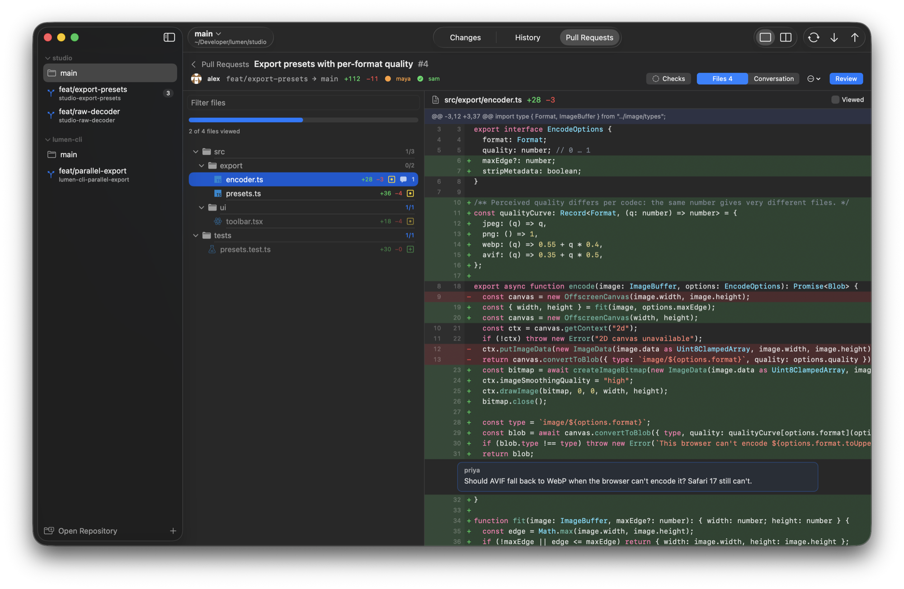
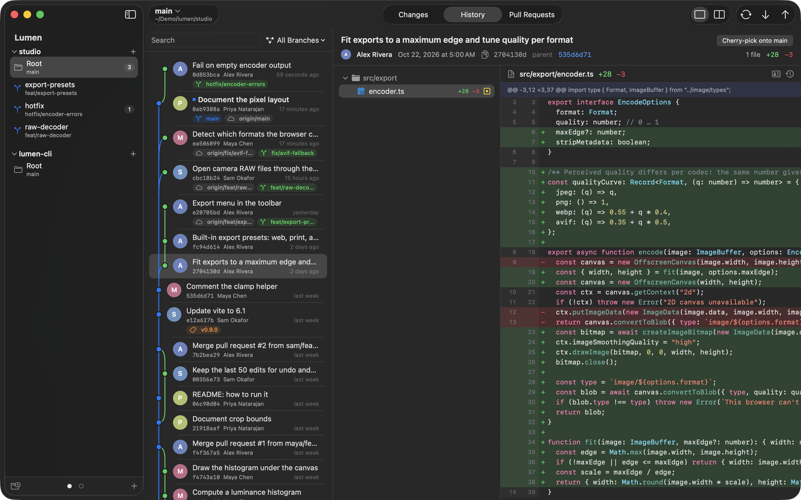
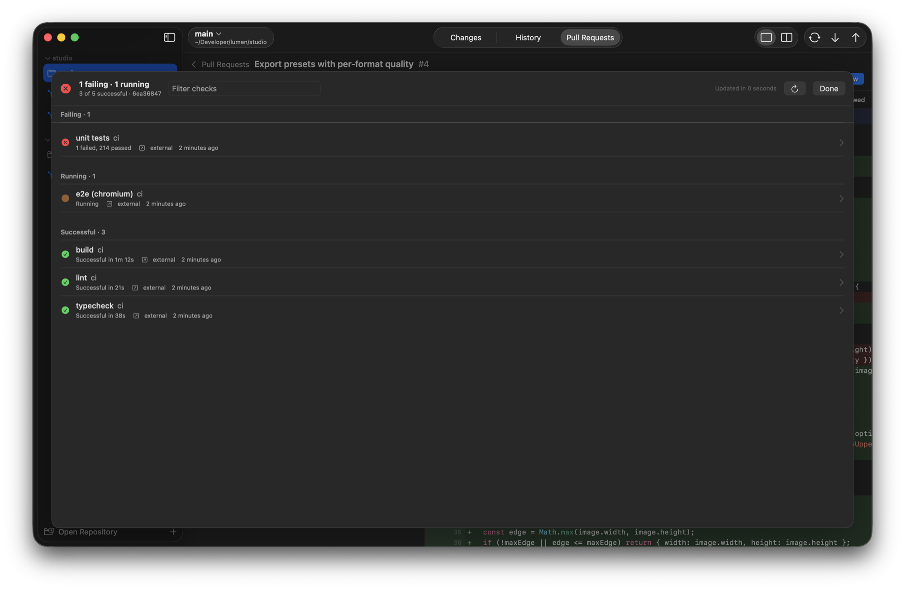

# Loupe

A native macOS git client built for reviewing code: your own uncommitted changes, large pull requests on
GitHub, Forgejo and Gitea, and many worktrees across many repositories at once.

Loupe is a SwiftUI app with an AppKit diff renderer. Every git operation runs through the `git` command line,
so worktrees, hooks, commit signing and credential helpers behave exactly as they do in your terminal.







## Features

**Repositories and worktrees**
- The sidebar lists every repository you add, each with all of its worktrees: branch, ahead/behind counts and
  the number of uncommitted changes. Repositories collapse; a collapsed one still shows its change count.
- ⌘K jumps to any worktree in any repository. Results are ordered by recent use, so ⌘K ↩ returns to the
  previous worktree.
- Switch the branch of the current worktree from the title bar. Picking a remote branch creates a local
  branch that tracks it.
- Create worktrees from a new or an existing branch, remove and prune them, and open them in Finder,
  Terminal, Zed or VS Code.
- The file list updates as soon as files change on disk, including a linked worktree's index under
  `.git/worktrees/`.

**Local changes**
- Staged and unstaged lists, unified or split diff, syntax highlighting for about twenty languages,
  intra-line highlights.
- Stage, unstage or discard a single hunk or a whole file. Commit and amend. Discarded untracked files go to
  the Trash.

**History**
- The commit log of the checked-out branch, searchable by message or author, with each commit's full diff.
- Start a new worktree from any commit.

**Pull requests**
- List and filter pull requests, then open one full-width with a collapsible file tree.
- Mark files as viewed, then jump to the next unviewed one. Viewed state is tied to the content of each
  file's diff, so a file changed by a new push becomes unviewed again.
- Review comments render inline at their lines. Right-click a line and choose Add Comment to write one.
  Drafts survive restarts.
- Submit as Comment, Approve or Request Changes; merge; read and reply in the conversation tab.
- Check out a pull request into its own worktree.
- See CI status. Forgejo Actions logs stream live inside the app; GitHub checks open in the browser.

**Performance**
- The diff is a virtualized `NSTableView` whose rows draw themselves. A 150,000-line file opens in under a
  second and scrolls smoothly; the parser handles 200,000 diff lines in about 40 ms.
- GitHub refuses to serve diffs over 300 files or 20,000 lines. Loupe fetches the pull request and computes
  the same diff locally instead.

## Requirements

macOS 15 or later, and git (the Xcode Command Line Tools or Homebrew git).

## Building from source

Building needs Xcode 16 or later (Swift 6 toolchain).

```sh
git clone https://github.com/exTypen/loupe.git
cd loupe
scripts/bundle.sh            # builds build/Loupe.app
scripts/bundle.sh --install  # also copies it to /Applications
```

`bundle.sh` signs with the first code-signing identity it finds: a Developer ID certificate, then an Apple
Development one, then an ad-hoc signature. With an ad-hoc signature macOS asks for Keychain access again after
every rebuild, because the stored tokens are bound to the app's signature. Set `LOUPE_SIGN_ID` to choose an
identity.

## Connecting accounts

Pull requests need an account for the server the repository's remote points to. Open Settings (⌘,) and add
one. HTTPS and SSH remotes both work; Loupe matches them to an account by hostname.

**GitHub**: choose GitHub. **Use GitHub CLI Token** takes the token that `gh auth login` stored. You can also
paste a personal access token. A fine-grained token needs read and write access to Pull requests, and read
access to Contents, Commit statuses and Checks. For GitHub Enterprise Server, enter your server's URL.

**Forgejo or Gitea**: enter the server URL and an access token from Settings → Applications, with
read and write access to `repository` and `issue`.

Tokens are stored in the macOS Keychain.

## Keyboard shortcuts

| Key | Action |
|---|---|
| ⌘K | Go to worktree |
| ⌘O | Open a repository (or drag a folder onto the window) |
| ⌥↓ / ⌥↑ | Next / previous file |
| `n` / `p` (in diff) | Next / previous hunk |
| `v` (in diff) or ⇧⌘V | Mark the file viewed and go to the next unviewed one |
| Space (file list) | Stage / unstage the selected file |
| ⌘↩ | Commit, add a comment, or submit a review |
| ⌘R | Refresh |
| ⌘[ | Back to the pull request list |

## Development

```sh
swift build
swift test                                   # parser, hunk staging against a real repository, highlighting
LOUPE_GH_LIVE=1 swift test --filter GitHubLive   # GitHub client against api.github.com (uses `gh auth token`)
```

`scripts/release.sh` builds a signed, notarized and stapled DMG. Its header lists the one-time setup: a
Developer ID Application certificate and stored notary credentials.

## Not built yet

Line-level staging, a conflict resolution UI, threaded replies to review comments, re-running CI jobs, a commit
graph, live GitHub Actions logs, and syncing viewed files with GitHub.

## License

[MIT](LICENSE).

File-type icons come from [Material Icon Theme](https://github.com/material-extensions/vscode-material-icon-theme)
(MIT) and are embedded by `scripts/gen-file-icons.py`.
